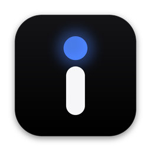
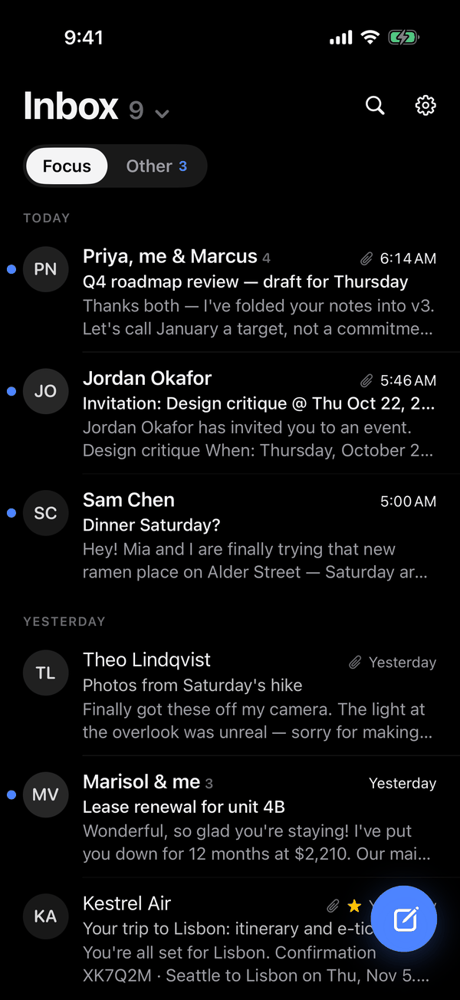
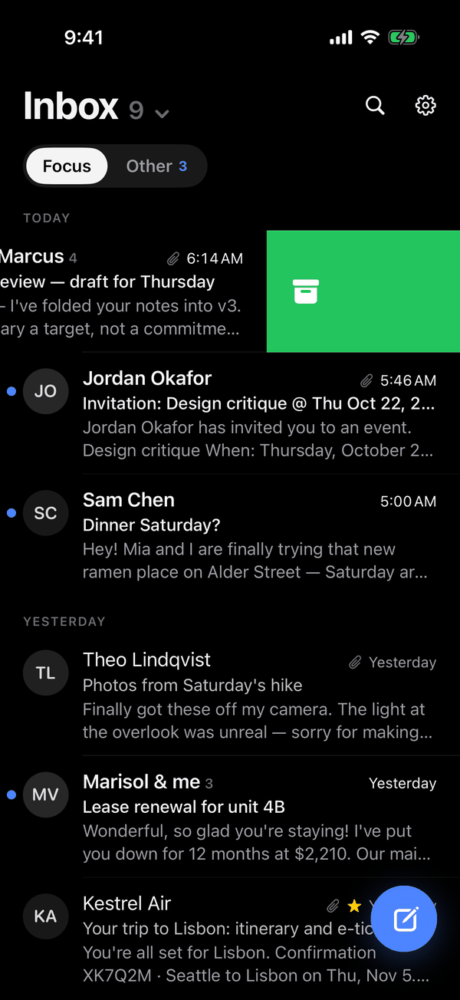
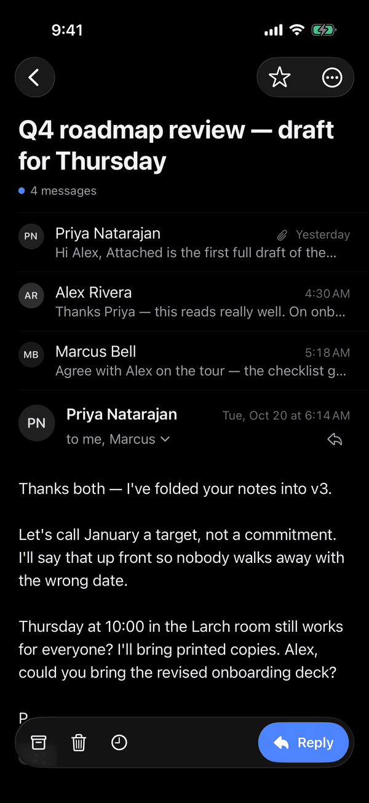
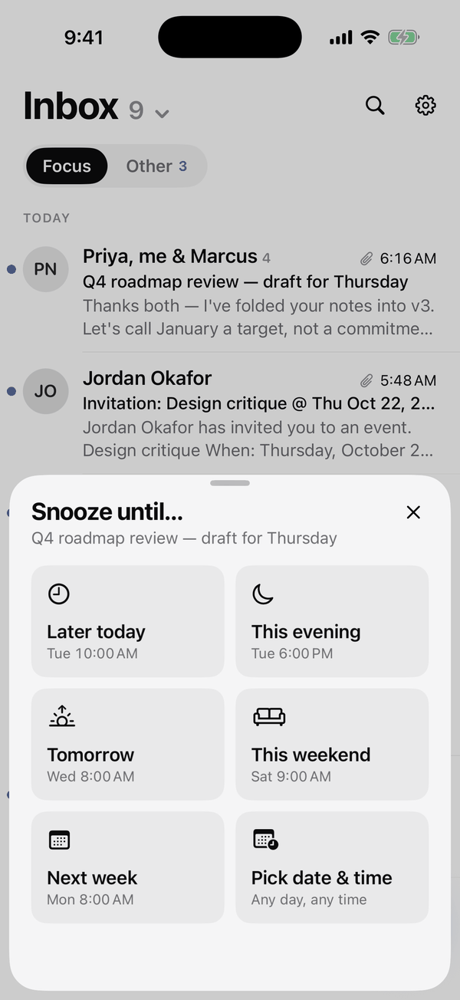
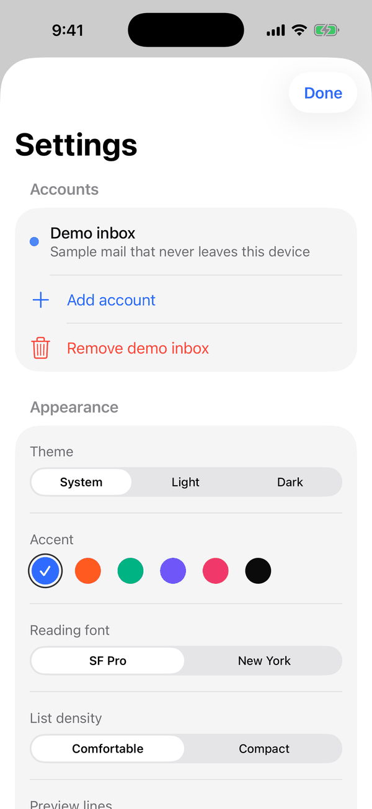
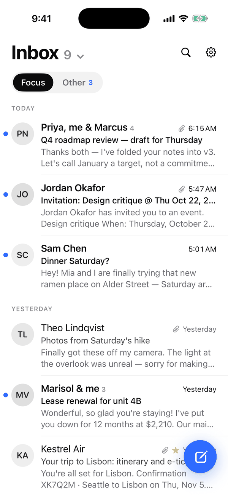
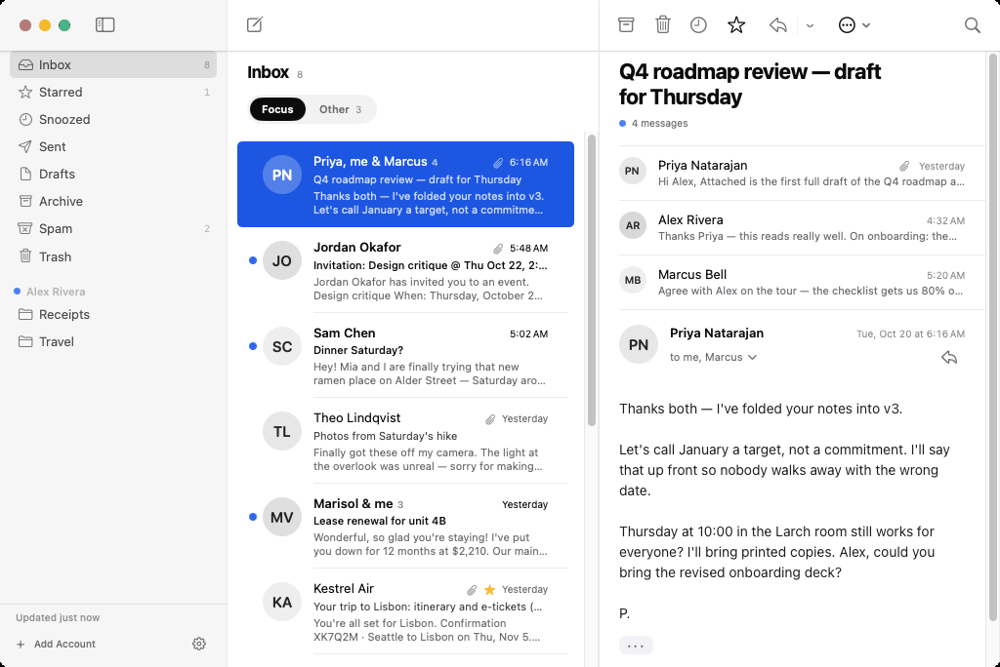

# Ink

Email, quieter. A native email app for iPhone and Mac: black and white, one hint of colour,
120 Hz smooth, built around swipes and the keyboard.

  
  
  
  

  
  
  
  

Screenshots use the built-in demo inbox and are captured by CI on every build.

## What it does

- **Your accounts, directly.** Gmail, iCloud, Outlook, Yahoo, Fastmail and any IMAP server. Ink
  talks to your provider over IMAP and SMTP with TLS. There's no Ink server in between, and
  passwords stay in the Keychain. [How to connect each provider →](docs/ACCOUNTS.md)
- **All Inboxes, split in two.** People in **Focus**; newsletters and notifications in **Other**.
- **Swipe to triage.** Swipe left a little to archive, further to trash. Swipe right to mark read,
  further to snooze. Each threshold gives a haptic tick and its own colour, and every swipe is
  configurable. Undo is always one tap away: actions wait a few seconds before they reach the server.
- **Snooze** to later today, tonight, tomorrow, the weekend or next week. Snoozed mail comes back
  to the top, unread.
- **Undo Send.** Messages wait 5 seconds (configurable) before they go.
- **Private by default.** Remote images (how senders track opens) are blocked until you ask. Ink
  counts the tracking pixels it blocked. One-click unsubscribe where the sender supports it.
- **Reads beautifully.** Plain emails get clean typography (SF Pro or New York). Designed
  newsletters keep their design and scale to fit. Quoted replies fold away.
- **Mac:** three panes, trackpad swipes, hover actions on each row, `⌘Z` to undo triage and sends,
  and Superhuman-style keys: `j`/`k` move, `e` archive, `#` trash, `r`/`a`/`f` reply, reply all,
  forward, `c` compose, `s` star, `u` unread, `h` snooze, `/` search, `⌘K` command palette.
- **Accessible:** every swipe is also a VoiceOver action, toasts like "Archived · Undo" are spoken,
  and text follows Dynamic Type, including inside emails.
- **Demo inbox** to try everything without connecting an account.

## Install

- **Mac:** download **Ink.dmg** from the
  [`ink-latest` release](https://github.com/farhanhaque0619/beats/releases/tag/ink-latest), drag it to
  Applications, then System Settings › Privacy & Security › **Open Anyway** the first time.
- **iPhone:** open `Ink/Ink.xcodeproj` in Xcode, sign with your Apple ID and press Run (free, renew
  every 7 days), or use TestFlight with a paid developer account. CI can upload for you.

Step by step: [docs/INSTALL.md](docs/INSTALL.md).

## How it's built

- `InkCore/`: a Swift package with every non-UI piece, written from scratch: an IMAP client
  (incremental parser, literals, IDLE, CONDSTORE, Gmail extensions, MOVE fallbacks), an SMTP client
  (STARTTLS, PLAIN/LOGIN/XOAUTH2), MIME parsing and building (encoded words, RFC 2231, dozens of
  charsets, format=flowed), threading, a local cache and the observable `MailStore` the UI binds
  to. Foundation only, so it builds and tests on Linux too.
- `App/`: SwiftUI for both platforms from one folder. `Design/Theme.swift` holds the whole visual
  language.
- `docs/`: [research notes](docs/RESEARCH.md), [architecture](docs/ARCHITECTURE.md),
  [UI spec](docs/UI.md).
- CI (`.github/workflows/ink.yml`): tests on Linux and macOS, builds the universal Mac app and DMG
  and an unsigned IPA, captures simulator screenshots, publishes `ink-latest`, and can upload to
  TestFlight.

Requires iOS 18 or macOS 15 (Sequoia) or later. Built with Xcode 26.
