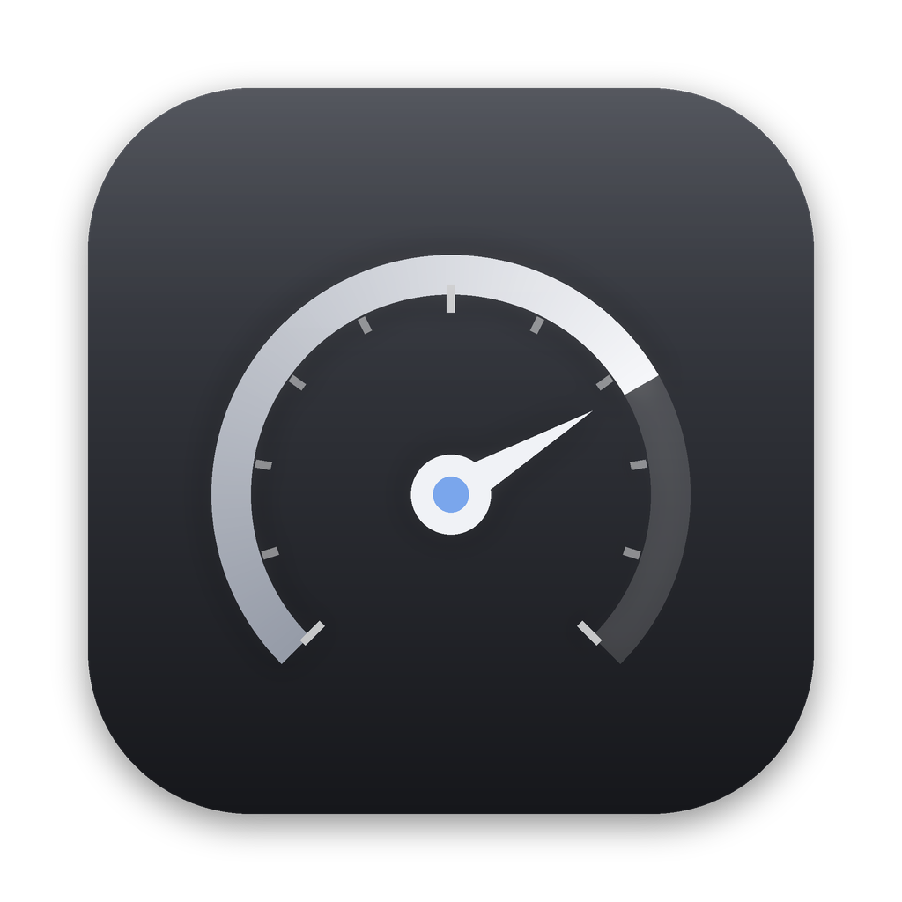

# Bassline

A Mac equalizer that gives each of your headphones and speakers its own sound. Every output your Mac can play through gets its own EQ: built-in speakers, displays, USB DACs, AirPlay and any Bluetooth device. **Beats Studio Pro**, **AirPods Pro 2**, and **Marshall Acton III** also get tuned bass-forward starting points. Bassline switches to the right EQ the moment your Mac starts playing through a device.



## What it does

- **Works on everything your Mac plays**: Spotify, Apple Music, YouTube in Safari or Chrome, games, all of it.
- **A separate profile for each device.** Connect your Beats and the Beats EQ turns on. Switch to AirPods and the AirPods EQ takes over. New devices appear on their own and start flat.
- **Bass-forward starting points** written for each product:
  - *Beats Studio Pro*: a strong sub and mid-bass lift. Studio Pro is tuned much flatter than older Beats, so this brings the punch back.
  - *AirPods Pro 2*: a smaller lift, because Adaptive EQ already adds some low end.
  - *Marshall Acton III*: the lift sits in the upper bass (64–250 Hz), because the speaker can't reproduce 32 Hz. Turn up the speaker's own **Bass** knob too.
- **10-band EQ** (32 Hz to 16 kHz) with a live frequency-response curve.
- **Bass Boost**: one slider that adds a smooth low shelf under 110 Hz on top of the bands.
- **Prevent distortion**: lowers the output by exactly as much as you boost, and a soft limiter catches peaks, so heavy bass stays clean.
- **Menu bar control**: switch the EQ on or off, change presets, set Bass Boost, and pick the Mac's sound output without opening the window.
- **Settings** (⌘,): open at login, Dock and menu bar visibility, soft limiter, reset or forget devices, live CPU and memory use, and **Check for Updates** with one-click install.
- **Liquid Glass** surfaces on macOS 26, with a frosted-glass look on earlier versions. The response curve and faders animate in step with the display, so they run at 120 Hz on ProMotion screens.
- Presets: Signature Bass (per device), Flat, Bass Boost, Deep Bass, Warm, V-Shape, Loudness, Vocal.

## Install

1. Open the [latest release](https://github.com/farhanhaque0619/beats/releases/latest) and download **Bassline.dmg**.
2. Open the DMG and drag **Bassline** into **Applications**.
3. Open Bassline. The app isn't notarized by Apple, so the first launch is blocked:
   - Open **System Settings › Privacy & Security**, scroll down, and click **Open Anyway** next to the Bassline message.
   - Or in Terminal: `xattr -dr com.apple.quarantine /Applications/Bassline.app`
4. When macOS asks whether Bassline can access system audio, click **Allow**. Bassline needs this to process the sound. Audio is never recorded or saved.

If music goes silent after you turn the EQ on, permission was denied. Allow Bassline under **System Settings › Privacy & Security › Screen & System Audio Recording**, or turn the equalizer off to get sound back instantly. Quitting Bassline always returns audio to normal.

**Requires macOS Sonoma 14.2 or later** on an Apple silicon or Intel Mac.

## Updating

Bassline 1.1 and later update themselves: **Settings › Updates › Install and Relaunch**. To update from Terminal instead:

```bash
osascript -e 'quit app "Bassline"' 2>/dev/null
curl -L -o /tmp/Bassline.dmg https://github.com/farhanhaque0619/beats/releases/latest/download/Bassline.dmg
hdiutil attach /tmp/Bassline.dmg -nobrowse -quiet -mountpoint /tmp/BasslineDMG
rm -rf /Applications/Bassline.app
ditto /tmp/BasslineDMG/Bassline.app /Applications/Bassline.app
hdiutil detach /tmp/BasslineDMG -quiet
xattr -dr com.apple.quarantine /Applications/Bassline.app
open /Applications/Bassline.app
```

## Performance

Bassline only processes audio while the current device's EQ is on and not flat. The rest of the time it sits idle in the menu bar. While equalizing, the filters use well under 1% of one CPU core, and the app uses roughly 30–60 MB of memory. Settings › About shows live numbers. The EQ adds about 20 ms of delay, which is small next to Bluetooth's own latency.

## How it works

Bassline uses Core Audio *process taps*, added in macOS 14.2. It taps the Mac's output mix, mutes the original, runs it through a chain of biquad filters, and plays the result to your real output device through a private aggregate device. No audio driver or system extension is installed. When the EQ is off or the app quits, macOS removes the tap and audio flows directly again.

When a Bluetooth device has a microphone (AirPods, Beats), Bassline turns off that microphone stream so the headphones stay in high-quality stereo mode.

## Limits

- Bassline changes what your **Mac** plays. It can't write settings into the headphones themselves, so it doesn't affect them when they're connected to your iPhone. On iPhone you can get a similar effect with Settings › Apps › Music › EQ › **Bass Booster** (Apple Music), Spotify's built-in Equalizer, or Settings › Accessibility › Audio & Visual › **Headphone Accommodations**.
- The app is signed ad hoc, not with an Apple Developer ID. After you install an update, macOS may ask for audio permission again.

## Build from source

You need macOS 14.2+ and Xcode 15.3 or later.

```bash
./scripts/build-app.sh   # builds build/Bassline.app (universal)
./scripts/make-dmg.sh    # packages build/Bassline.dmg
```

Every push runs the same build on GitHub Actions (`.github/workflows/build.yml`), attaches the DMG to the workflow run, and updates the GitHub release.

```
Sources/Bassline/
  Audio/   Core Audio device helpers, the realtime EQ processor, and the tap engine
  Model/   Device profiles, presets, filter design, and app state
  Views/   SwiftUI window, band sliders, response curve, and menu bar panel
```
